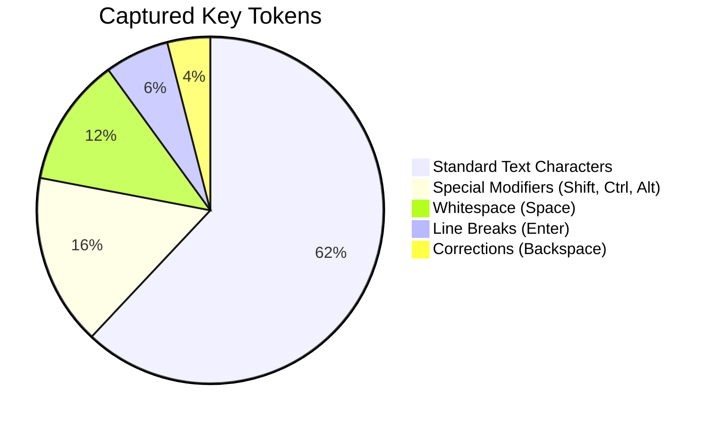
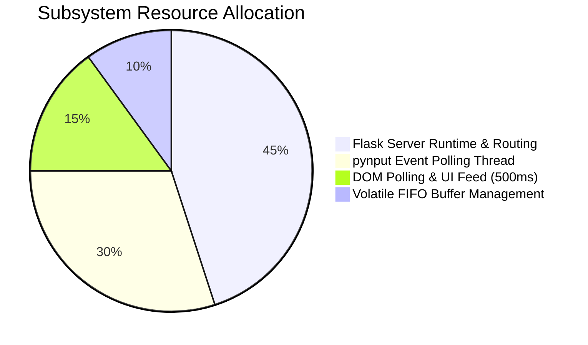
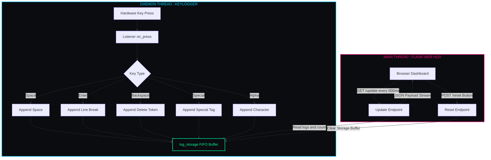

<div align="center">

<h1 style="font-family: 'Cooper Black', 'Arial Black', serif; font-size: 4rem; letter-spacing: 2px; color: #00ff99; margin-bottom: 2px; text-shadow: 0 0 25px rgba(0, 255, 153, 0.45);">
  ⚡ SHADOWTRACE ⚡
</h1>

<h3 style="font-family: 'Bookman Old Style', 'URW Bookman', 'Georgia', serif; font-weight: 500; color: #00d4ff; margin-top: 6px; letter-spacing: 0.8px;">
  ◈ <i>Next-Gen Real-Time Telemetry & Keystroke Monitor</i> ◈
</h3>

<br/>

[](https://python.org)
[](https://flask.palletsprojects.com/)
[](https://pynput.readthedocs.io/)
[](#)
[](LICENSE)

<br/>

<p align="center" style="font-family: 'Bookman Old Style', 'URW Bookman', serif; font-size: 1.05rem;">
  <b>✦ <a href="#01-system-overview">Overview</a> ✦</b> &nbsp;•&nbsp;
  <b>✦ <a href="#02-live-hud-preview">Console Preview</a> ✦</b> &nbsp;•&nbsp;
  <b>✦ <a href="#03-telemetry-metrics--charts">Telemetry Charts</a> ✦</b> &nbsp;•&nbsp;
  <b>✦ <a href="#04-event-parsing-logic">Parser Logic</a> ✦</b> &nbsp;•&nbsp;
  <b>✦ <a href="#05-system-architecture">Architecture</a> ✦</b> &nbsp;•&nbsp;
  <b>✦ <a href="#06-quick-start">Quick Start</a> ✦</b> &nbsp;•&nbsp;
  <b>✦ <a href="#07-api-endpoints">API Endpoints</a> ✦</b>
</p>

---

</div>

<h2 id="01-system-overview" style="font-family: 'Bookman Old Style', 'URW Bookman', 'Georgia', serif; color: #00ff99;">🌌 01. System Overview</h2>

<p style="font-family: 'Bookman Old Style', 'URW Bookman', serif; font-size: 1.05rem; line-height: 1.7;">
<b>ShadowTrace</b> is an asynchronous keystroke monitoring tool featuring a live web HUD. Built with <b>Python</b>, <b>Flask</b>, and <b>pynput</b>, it executes a hardware listener on a dedicated daemon thread and streams live input into a dark cyberpunk terminal interface on port <code>5005</code>.
</p>

```
  ┌─────────────────────────┐      ┌─────────────────────────┐      ┌─────────────────────────┐
  │  ⌨️  pynput Listener    │ ──❯  │ 🧠 log_storage (1000)   │ ──❯  │ 🖥️  Flask Terminal HUD  │
  │     (Daemon Thread)     │      │    Ring Buffer FIFO     │      │     (0.0.0.0:5005)      │
  └─────────────────────────┘      └─────────────────────────┘      └─────────────────────────┘
```

> [!NOTE]
> **Non-Blocking Execution**: The keylogger runs concurrently on a daemon thread, ensuring zero input lag and zero missed keystrokes.

---

<h2 id="02-live-hud-preview" style="font-family: 'Bookman Old Style', 'URW Bookman', 'Georgia', serif; color: #00ff99;">📸 02. Live HUD Preview</h2>

<div align="center">

<kbd>
  
</kbd>

<br/>
<sub style="font-family: 'Bookman Old Style', 'URW Bookman', serif;"><b>◈ Figure 1.0:</b> Real-time Cyber Feed Terminal (<code>#live-feed</code>), keystroke counter, and buffer reset controls.</sub>

</div>

---

<h2 id="03-telemetry-metrics--charts" style="font-family: 'Bookman Old Style', 'URW Bookman', 'Georgia', serif; color: #00ff99;">📊 03. Telemetry Metrics & Charts</h2>

### 🥧 Key Event Categorization


### 🛰️ Subsystem Execution Profile


---

<h2 id="04-event-parsing-logic" style="font-family: 'Bookman Old Style', 'URW Bookman', 'Georgia', serif; color: #00ff99;">🔍 04. Event Parsing Logic</h2>

<p style="font-family: 'Bookman Old Style', 'URW Bookman', serif; font-size: 1.02rem;">
Every keystroke is intercepted inside <code>on_press(key)</code> and parsed for HUD output:
</p>

| Key Event | Storage Buffer Action | Internal String | HUD Visual Representation |
| :--- | :--- | :---: | :--- |
| **`Key.space`** | `log_storage.append(" ")` | `clean_text += " "` | `␣` *(Space)* |
| **`Key.enter`** | `log_storage.append("<br>[ENTER]<br>")` | `clean_text += "\n"` | `[ENTER]` *(Line break)* |
| **`Key.backspace`** | `log_storage.append(" [⌫] ")` | `clean_text = clean_text[:-1]` | `[⌫]` *(Deletes char)* |
| **`Key.*` (Special)** | `log_storage.append(f"<span class='special'>[{NAME}]</span>")` | *Ignored* | `<span style="color:#00ff99">[KEY]</span>` |
| **Alphanumeric** | `log_storage.append(key_str)` | `clean_text += key_str` | Raw character text |

> [!TIP]
> **FIFO Queue Constraint**: If <code>len(log_storage) > 1000</code>, the oldest event is removed (<code>log_storage.pop(0)</code>), keeping memory usage bounded.

---

<h2 id="05-system-architecture" style="font-family: 'Bookman Old Style', 'URW Bookman', 'Georgia', serif; color: #00ff99;">🧬 05. System Architecture</h2>



---

<h2 id="06-quick-start" style="font-family: 'Bookman Old Style', 'URW Bookman', 'Georgia', serif; color: #00ff99;">🚀 06. Quick Start</h2>

### 📋 Prerequisites & Setup
- **Python 3.x**
- OS input monitoring / accessibility permissions

```bash
# 1. Install dependencies
pip install flask pynput

# 2. Run the application
python ShadowTrace.py
```

### 🌐 Accessing Dashboard
- **Local machine**: `http://localhost:5005`
- **LAN devices**: `http://<YOUR_LOCAL_IP>:5005`

---

<h2 id="07-api-endpoints" style="font-family: 'Bookman Old Style', 'URW Bookman', 'Georgia', serif; color: #00ff99;">🔌 07. REST API Endpoints</h2>

<details open>
<summary><b>📡 <code>GET /update</code> — Stream Live Feed & Counter</b></summary>

Polled every **500ms** by the web terminal JavaScript.

```json
{
  "count": 4,
  "logs": ["c", "m", "d", "<br>[ENTER]<br>"]
}
```
</details>

<details open>
<summary><b>🛑 <code>POST /reset</code> — Clear Stored Buffer</b></summary>

Clears `log_storage` and resets `clean_text`.

```json
{
  "count": 0,
  "logs": [],
  "status": "success"
}
```
</details>

---

<h2 id="08-disclaimer" style="font-family: 'Bookman Old Style', 'URW Bookman', 'Georgia', serif; color: #00ff99;">🛡️ 08. Disclaimer</h2>

> [!CAUTION]
> **EDUCATIONAL & AUTHORIZED USE ONLY.**  
> ShadowTrace is designed strictly for research, authorized diagnostics, and personal activity logging. Always obtain explicit permission before monitoring any device.

---

<h2 id="09-license" style="font-family: 'Bookman Old Style', 'URW Bookman', 'Georgia', serif; color: #00ff99;">📜 09. License</h2>

Distributed under the **[MIT License](LICENSE)**.

<div align="center">

---

⭐ **Star this repository if you find ShadowTrace helpful!** ⭐

<p style="font-family: 'Bookman Old Style', 'URW Bookman', serif; color: #64748b; margin-top: 8px;">
 
</p>

</div>
